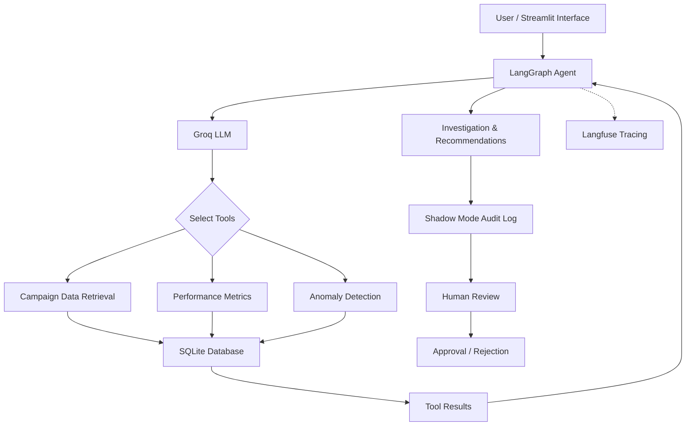

# AdOps Agent — Autonomous Advertising Operations Assistant

An AI-powered advertising operations assistant built with **Python, LangGraph, Groq, and Streamlit** to investigate campaign performance, detect anomalies, identify budget overruns, and generate recommendations for human review.

The project demonstrates how agentic AI workflows can support advertising operations through tool calling, structured data analysis, execution tracing, and human-in-the-loop decision-making.

## Overview

Advertising operations teams need to continuously monitor campaign performance, identify unexpected changes, and make informed optimization decisions.

AdOps Agent addresses this challenge through an AI-driven investigation workflow. It retrieves campaign data from a SQLite database, uses Python-based analytical tools to calculate performance metrics, identifies potential issues, and generates contextual recommendations.

Instead of directly modifying campaigns, the agent operates in **Shadow Mode**, recording its recommendations for human review and requiring an explicit approval or rejection.

## Key Features

- **AI-Powered Campaign Investigation:** Uses a Groq-hosted LLM through LangGraph to understand investigation requests and coordinate the appropriate tools.
- **Automated Performance Analysis:** Calculates Click-Through Rate (CTR), conversion rate, and budget utilization.
- **Anomaly Detection:** Identifies significant day-to-day impression drops using a configurable 40% decline threshold.
- **Budget Monitoring:** Detects campaigns that exceed their allocated budgets.
- **Agentic Tool Calling:** Dynamically invokes Python tools to retrieve campaign information, calculate metrics, and investigate anomalies.
- **Instruction-Driven Agent:** Uses a `SKILL.md` file to define the agent's role, investigation workflow, analytical rules, and safety constraints.
- **Shadow Mode:** Stores AI-generated recommendations in a structured JSONL audit log without executing campaign changes.
- **Human-in-the-Loop:** Records human approval or rejection of recommendations.
- **Execution Tracing:** Integrates Langfuse to monitor and inspect agent execution.
- **Evaluation:** Includes baseline test scenarios covering budget overrun detection, impression-drop detection, and normal campaign performance.
- **Interactive Dashboard:** Provides a Streamlit interface for campaign selection, investigation, metric visualization, and recommendation review.

## Technology Stack

| Category | Technologies |
|---|---|
| Programming Language | Python |
| LLM API | Groq |
| Agent Framework | LangGraph, LangChain |
| Database | SQLite |
| Data Analysis | Pandas |
| Data Validation | Pydantic |
| Observability | Langfuse |
| Frontend | Streamlit |
| Environment & Dependency Management | uv |

## Architecture

The application follows a tool-based agentic workflow.



## Project Structure

```text
adops-agent/
│
├── app/
│   ├── agent/
│   │   ├── graph.py
│   │   ├── state.py
│   │   └── prompts.py
│   │
│   ├── tools/
│   │   ├── campaign_tools.py
│   │   └── analysis_tools.py
│   │
│   ├── database/
│   │   ├── db.py
│   │   └── seed.py
│   │
│   ├── evaluation/
│   │   └── shadow_mode.py
│   │
│   ├── main.py
│   └── streamlit_app.py
│
├── data/
│   └── campaigns.csv
│
├── skills/
│   └── SKILL.md
│
├── logs/
│
├── .env
├── .gitignore
├── pyproject.toml
└── README.md
```

## How It Works

1. **Campaign Selection:** The user selects a campaign through the Streamlit interface.
2. **Data Retrieval:** The agent retrieves relevant campaign information from SQLite using Python tools.
3. **Performance Analysis:** Analytical functions calculate CTR, conversion rate, and budget utilization.
4. **Anomaly Investigation:** The agent checks daily campaign records for significant impression declines.
5. **LLM Reasoning:** LangGraph coordinates tool execution and sends retrieved results to the Groq-powered model for interpretation.
6. **Recommendation Generation:** The agent summarizes findings and suggests appropriate actions.
7. **Shadow Mode Logging:** The investigation is stored with a unique recommendation ID and a pending review status.
8. **Human Review:** A user can approve or reject the recommendation. The decision is recorded in the audit log.

## Evaluation Results

The project includes three baseline evaluation scenarios to verify campaign investigation and detection logic.

| Test Scenario | Expected Behaviour | Result |
|---|---|---|
| CMP103 — Budget Overrun | Detect spending above the allocated budget | PASS |
| CMP102 — Impression Drop | Identify a significant impression decline | PASS |
| CMP101 — Normal Performance | Identify the absence of significant impression drops | PASS |

**Evaluation Summary**

- Total test scenarios: 3
- Passed: 3
- Failed: 0

These results represent baseline validation using the included synthetic dataset, rather than a measure of production-level reliability.

## Getting Started

### Prerequisites

- Python 3.11 or compatible version
- Git
- Groq API key
- Langfuse account and API credentials (for execution tracing)

### 1. Clone the Repository

```bash
git clone https://github.com/YOUR_USERNAME/adops-agent.git
cd adops-agent
```

### 2. Install Dependencies

Install [uv](https://docs.astral.sh/uv/) if it is not already available.

```bash
uv sync
```

If you are not using the lockfile, install the project dependencies using the dependency configuration in `pyproject.toml`.

### 3. Configure Environment Variables

Create a `.env` file in the project root:

```env
GROQ_API_KEY=your_groq_api_key
GROQ_MODEL=your_groq_model

LANGFUSE_PUBLIC_KEY=your_langfuse_public_key
LANGFUSE_SECRET_KEY=your_langfuse_secret_key
LANGFUSE_BASE_URL=https://cloud.langfuse.com
```

Replace the placeholder values with your own credentials. Keep `.env` private and never commit API keys to GitHub.

Langfuse credentials are required for tracing; Groq credentials are required to run the AI agent.

### 4. Initialize the Database

The SQLite database is generated locally from the included synthetic campaign dataset.

```bash
uv run python -m app.database.seed
```

### 5. Run the Application

Launch the Streamlit interface:

```bash
uv run streamlit run app/streamlit_app.py
```

Open the local URL displayed in your terminal, usually:

```text
http://localhost:8501
```

You can also run the terminal-based agent:

```bash
uv run python -m app.main
```

## Safety and Design Considerations

- Campaign data is retrieved from the application's local database.
- Analytical findings are based on retrieved data rather than invented metrics.
- Potential causes are distinguished from confirmed observations.
- Recommendations are logged for human review.
- Approval and rejection are recorded for audit purposes.
- The current implementation does not execute changes on live advertising campaigns.

## Future Improvements

- Integrate advertising platform APIs for real-time campaign data.
- Expand evaluation with additional scenarios and edge cases.
- Introduce more advanced anomaly detection techniques.
- Build persistent recommendation and approval state management.
- Add role-based access control and more comprehensive audit capabilities.
- Explore multi-agent workflows for specialized advertising operations tasks.
- Deploy the application for public access.

## Project Context

This project was developed as a portfolio exploration of **Agentic AI and autonomous enterprise workflows**, focusing on how LLM-powered agents can interact with structured data, use externalized instructions, coordinate tools, and operate with human oversight.

The included campaign dataset is synthetic and intended for demonstration and evaluation purposes.

---

**Built with Python, LangGraph, Groq, and Streamlit.**
